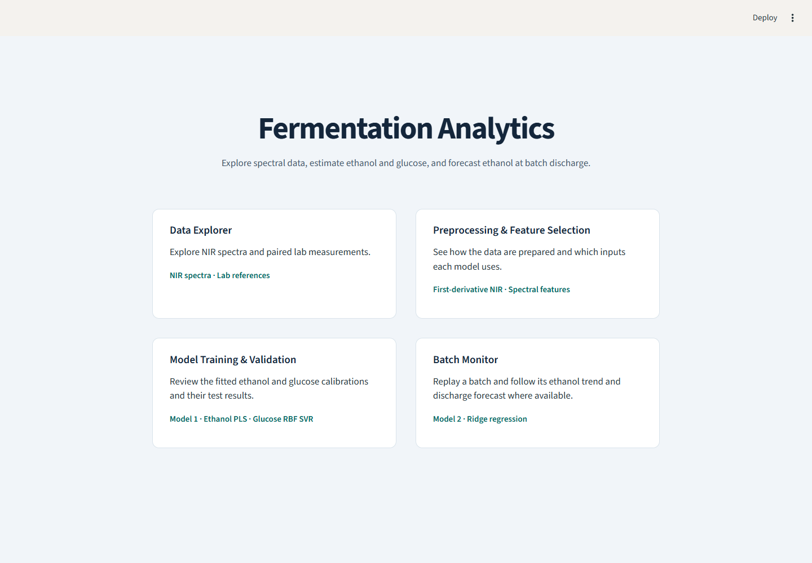

# Home and return navigation redesign

26 November 2026 · [Open the local app](http://127.0.0.1:8509/)

Home opens at the root URL. Its title, introduction, and four module cards are centred in the full viewport. Streamlit's navigation column is hidden on Home and all four modules. Each module displays its own content and a **← Back to Home** link. Home's cards form a 2 × 2 grid when space allows and stack in one column on narrow screens. Each card uses a single native Streamlit link with a full-card pointer target, a teal keyboard focus outline, and a subtle hover treatment.

## Checks performed

- Opened a new Chrome session at `/` and confirmed Home was selected. Verified one main heading, exactly four cards, and one distinct link per card. At every tested width, Home's main area started at the viewport's left edge and filled the full viewport width. The title area and card grid were centred, and neither the sidebar nor its expand control was visible.
- Verified Tab order across all four cards and a visible focus outline on each. Exercised keyboard activation and pointer activation from inside a card, away from its title.
- Opened all four modules at their expected routes and checked their headings and a representative control on each page. Verified that the main area filled the viewport on every module without a sidebar or expand control. Each **← Back to Home** link appeared above the module heading and returned to `/` with Enter.
- At 1,440 px, all four cards measured 433 × 196 CSS pixels. The grid used two columns at 1,440 and 768 px and one column at 390 and 320 px, without clipped text or horizontal overflow. The longest card title wrapped at 320 px.

All requested checks were completed in local headless Chrome. Other browser engines, screen readers, and physical mobile devices were outside the verification scope.

## Files changed

- `app.py` uses Streamlit's hidden navigation mode for all five pages and retains the existing page links.
- `HOME_NAVIGATION_REDESIGN.png` captures the full-width desktop Home.
- `HOME_NAVIGATION_REDESIGN_REPORT.md` records the changes and the browser checks.
